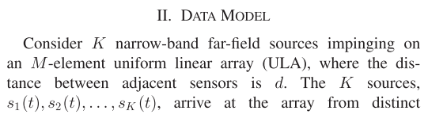
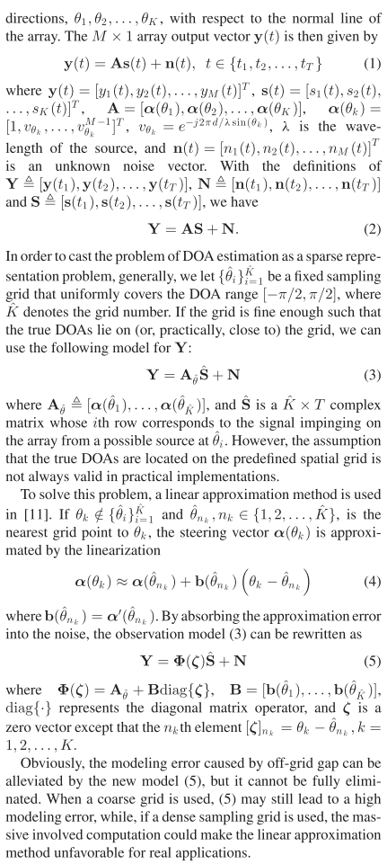
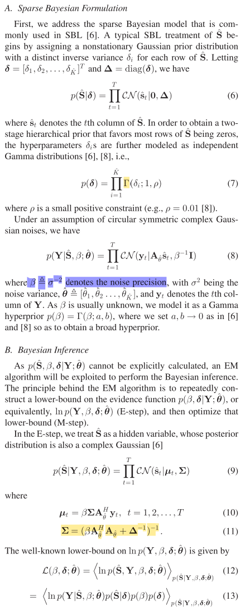
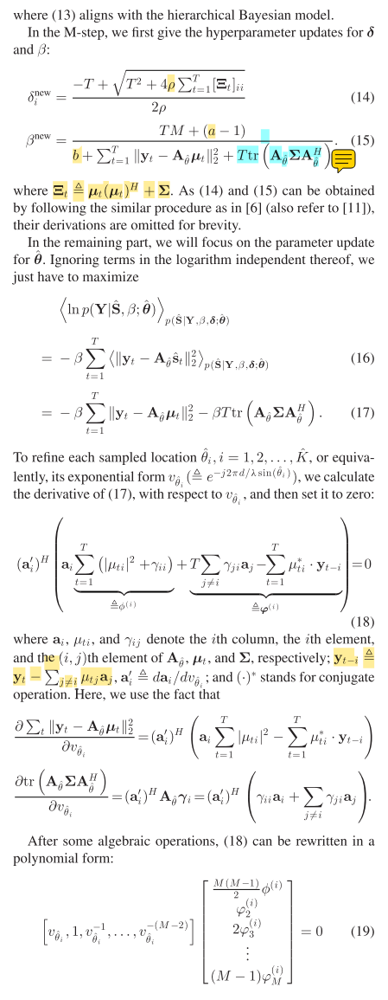
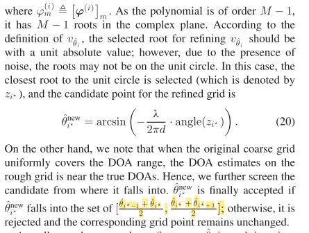
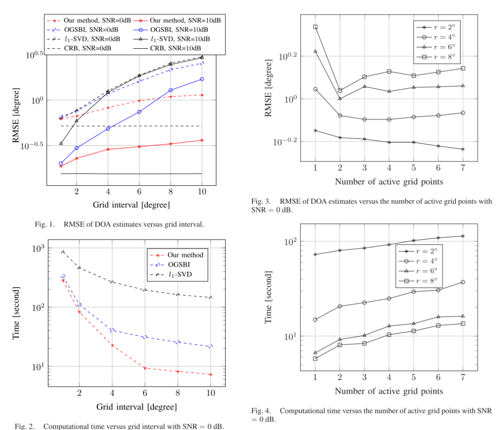

# Sparse Bayesian DOA Estimation Series - Off-the-Shelf DOA Estimation with Root Sparse Bayesian Learning [with MATLAB Code]

The performance of the sparse Bayesian learning (SBL) method for off-line direction of arrival (DOA) estimation depends on the trade-off between accuracy and computational effort. To accelerate the speed of off-line SBL methods while maintaining reasonable accuracy, this paper describes an efficient off-line DOA estimation root SBL method that employs a coarse grid and treats the sampling positions in the coarse grid as adjustable parameters. We utilize the expectation-maximization algorithm to iteratively refine this coarse grid and demonstrate that each updated grid point can be simply realized by a polynomial root. Simulation results show a significant reduction in computational complexity and nearly eliminate modeling errors.
Introduction: The estimation of direction of arrival (DOA) for narrowband sources is an important topic in array signal processing, attracting great interest in many fields such as radar, sonar, and mobile communication [1]. Traditional subspace-based DOA estimation methods, including MUSIC and ESPRIT, require a large number of snapshots to achieve their high resolution performance. They may not work when the signals are highly correlated or coherent due to multipath propagation. Recently, emerging sparse representation techniques have rekindled interest in DOA estimation problems [2]-[5]. Compared with traditional subspace-type methods, sparse representation methods exhibit many advantages, such as improved robustness to noise, limited number of snapshots, and signal correlation.
Sparse Bayesian Learning (SBL) [6], [7] is one of the most popular methods for sparse signal recovery, which leverages sparse information from a Bayesian perspective to make sparse prior assumptions about the desired signal. Theoretical results indicate that when using the Laplace signal prior, the maximum a posteriori optimal estimation includes the l1 norm minimization method as a special case [8], [9]. The excellent performance of SBL methods in DOA estimation largely depends on the assumption that the true DOA is located (actually, close to) at the sampling grid points. However, in practice, this assumption is often unrealistic. The gap between the true DOA and its nearest grid point is called the off-line gap.
The following is a translation of the Chinese text into English without providing any additional information or context:
Many methods have been proposed to improve off-grid DOA estimation [10]-[12]. Yang et al. [11] applied linear approximations to real DOA applications and proposed an off-grid SBL method, where the assumption is that the off-grid gaps are uniformly distributed (non-informative). Using the sample covariance matrix, Zhang et al. [12] further provided an improved off-grid SBL method to reduce the impact of noise variance. Existing methods [11] and [12] still pose a major issue as their performance depends on the trade-off between accuracy and computational effort. When using coarse grids, higher modeling errors may occur, while if a dense sampling grid is used, the substantial computational work involved may make this method unsuitable for practical applications.
In this letter, we attempt to propose a computationally efficient root SBL method for off-grid DOA estimation that employs a coarse grid and treats the sampling positions in the coarse grid as adjustable parameters. We utilize the expectation-maximization (EM) algorithm to iteratively refine this coarse grid, and explain that each updated grid point can be simply realized by a polynomial root. In this way, the computational complexity is significantly reduced, and the modeling error is almost eliminated.
ROOT-SBL DOA Estimation Theory
MATLAB Simulation Results
Conclusion We have proposed a computationally efficient root SBL method that addresses the problem of DOA estimation with off-grid model errors. Unlike the existing off-grid SBL method in [11] that applies linear approximations to real DOA applications, our new method treats the sampling positions in the coarse grid as adjustable parameters and utilizes the EM algorithm to iteratively refine the grid. We further explain that each updated grid point can be simply realized by a polynomial root (19). Simulation results indicate that the computational complexity is significantly reduced, and the modeling error is almost eliminated.

## Images

<!-- PAYMENT_BLOCK -->

## Get this dataset

- Payment link (Stripe): [Buy now](https://buy.stripe.com/3cs8yP7sY87d0vu9AB)
- Payment QR code: 

<!-- /PAYMENT_BLOCK -->
